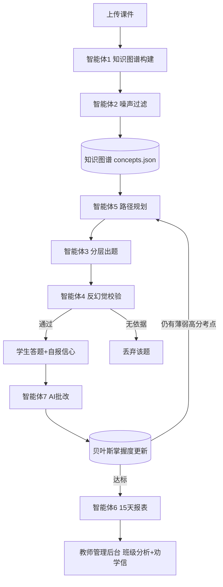

# ScholarPulse 学脉：基于 LangChain 多智能体的大学生学情分析与陪伴系统

**课程：生成式人工智能 课程设计报告**
**关键词：LangChain · LangGraph · 多智能体 · 知识图谱 · 贝叶斯掌握度 · 反幻觉 grounding**

---

## 摘要

现有课件类应用普遍停留在"文本切块 → 向量检索 → 随机出题"的单次问答范式，存在三个痛点：① LLM 凭印象出题，常产生讲义中并不存在的"幻觉考点"；② 学生学习状态被简化为对错计数，无法刻画每个考点的真实掌握概率；③ 千人一面推题，不能根据前置依赖关系做个性化路径规划。

本项目设计并实现 **ScholarPulse**，一个基于 **LangChain / LangGraph** 的多智能体学习陪伴系统。系统从课件中抽取带前置依赖与考试权重的**知识图谱**，用**贝叶斯掌握度**逐题更新每个考点的概率；六个专业化智能体协作完成"知识图谱构建 → 噪声过滤 → 分层出题 → 反幻觉校验 → 掌握度更新 → 路径规划 → 15天报表"的自适应闭环；并通过**信心校准**识别学生的"达克效应"假性掌握。系统提供学生端 Web 与教师管理后台，实测可在三路大模型（DeepSeek / 通义千问 / 豆包）间自动故障转移。

---

## 1. 选题背景与意义

高校复习场景中，学生面对海量讲义缺少"哪里不会、先补哪里、会不会真的考"的判断；教师则难以同时掌握几十个学生各自的薄弱点。生成式大模型为个性化辅导提供了可能，但直接调用 LLM 聊天会引入**幻觉、不可控、无状态**三大问题。本项目的目标是：用 LangChain 的智能体编排能力，把"一次性问答"改造成"有记忆、会自检、能闭环"的学习系统。

## 2. 相关工作

| 方向 | 代表做法 | 本项目改进 |
|---|---|---|
| RAG 课件问答 | 切块→向量库→检索生成 | 改为**知识图谱**，保留前置依赖与考试权重 |
| 自适应学习 | 对错计数 | **贝叶斯掌握度 + IRT 难度估计** |
| 间隔重复 | Anki 固定算法 | 与知识图谱弱点结合的**SM-2 调度** |
| 多智能体 | AutoGPT 通用任务 | 针对学习闭环的**六个有分工专家** |
| 可信度 | 事后人工抽查 | 出题后立即由**独立校验智能体 grounding** |

## 3. 系统架构



**技术栈**：Python 3.13 · LangChain Core（自定义 ChatModel）· LangGraph（StateGraph 闭环）· FastAPI（Web）· Pydantic · 多供应商 OpenAI 兼容接口。

## 4. 关键技术与创新点

1. **知识图谱而非向量块**：`ingest_agent` 用 LLM 抽取概念节点、前置依赖边 `prerequisites`、考试权重 `exam_weight`（由"重点/必考/掌握"等信号推断）。
2. **噪声过滤智能体**：`filter_agent` 把每段内容判为 `core / optional / filtered`，广告、题外话、重复表述不进入学习路径。
3. **贝叶斯掌握度引擎**（纯计算）：答对 `p += (1-p)·0.25`，答错 `p *= 0.65`，每个考点有独立掌握概率。
4. **反幻觉校验智能体**（核心创新）：出题后由第二个 LLM 逐条核对"该题能否从上传讲义推出"，找不到依据即 `grounded=false` 丢弃。**实测在第二轮丢弃了 2 道编造题。**
5. **分层出题 + 最短提分路径**：按平均掌握度把学生分为 foundation/consolidation/extension；在图上按 `(1-p)·考试权重` 排序求提分顺序。
6. **元认知与信心校准**：答题前学生自报 1–5 把握度，与 AI 批改得分对比，识别"高信心低得分"的**达克效应假性掌握**。
7. **AI 简答批改**：`meta_agent` 以阅卷老师角色给简答打 0/0.5/1 分并点评。
8. **考点押题预言 + 教师劝学信**：教师端聚合全班，自动生成待介入学生名单与一封可直接发送的个性化短信。
9. **间隔重复与遗忘曲线**：SM-2 调度复习节点，长期不复习掌握度指数回落。
10. **多供应商故障转移**：自定义 `RouterChatModel` 继承 `BaseChatModel`，DeepSeek→千问→豆包自动切换，对上层透明。

## 5. LangChain / LangGraph 实现要点

- **自定义 ChatModel**：`scholarpulse/lc_model.py` 继承 `langchain_core.language_models.BaseChatModel`，实现 `_generate()`，使系统可与 `ChatPromptTemplate | model | OutputParser` 标准 LCEL 链组合，也可被 LangGraph 节点直接调用。
- **编译状态图**：`scholarpulse/langgraph_app.py` 用 `StateGraph` 定义 `plan → quiz → answer` 节点与条件回边 `_route`，`app.invoke()` 驱动自适应闭环（实测 3 轮后停止）。
- **结构化输出**：各智能体要求 LLM 返回 JSON，配合容错解析（代码块剥离 + 截断括号补全），应对 `max_tokens=600` 下的输出截断。

## 6. 实验与结果（本机实测）

以《操作系统》第 2 章讲义为输入：

- **知识图谱**：抽取 8 个考点（进程、PCB、状态转换、线程、线程切换、死锁、四条件、银行家算法），权重 0.90–0.95。
- **反幻觉**：第二轮 4 题中 2 道被校验智能体判为"讲义无依据"并丢弃。
- **闭环效果**：答错"死锁"后其掌握度 0.47 → 0.31，下一轮自动把"死锁"排为提分收益第一（0.66）。
- **教师看板**：识别班级共性薄弱（PCB、线程、线程切换、死锁）与需介入学生，AI 生成一封关于"死锁"的个性化劝学信。
- **可用性**：学生端 `http://127.0.0.1:8000`，教师端 `/teacher`，多供应商故障转移生效。

## 7. 部署与运行

```bash
cd D:\ScholarPulse
pip install -r requirements.txt
# 配置 .env 中三家 LLM 密钥
start.bat                 # 启动 Web，学生端 http://127.0.0.1:8000
python run.py ingest      # 命令行：构建知识图谱
python run.py learn --sid s001 --simulate
python run.py graph-demo --sid s001   # 运行 LangGraph 编译状态图
```

## 8. 不足与展望

- 课件解析目前支持 TXT，下一步接入 `pypdf/python-docx` 支持 PDF/Word；
- 掌握度可升级为完整 **IRT 双参数模型**与考前倒计时排程；
- 教师端接入真实账号体系与定时推送（每 15 天自动生成报表）；
- 知识图谱可视化升级为可交互网状图。

## 参考文献

1. LangChain Documentation. https://python.langchain.com
2. LangGraph: Build language agents as graphs. https://langchain-ai.github.io/langgraph/
3. Ebbinghaus 遗忘曲线与 SM-2 间隔重复算法.
4. Item Response Theory (2PL) 简介.
5. Dunning-Kruger Effect（元认知校准）.
