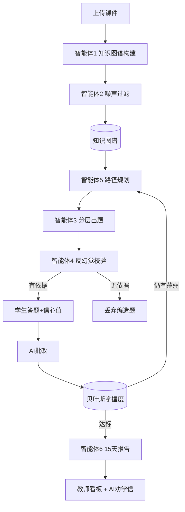

# ScholarPulse 学脉：基于 LangChain 多智能体的大学生学情分析与陪伴系统
### 大三《生成式人工智能》课程项目报告

---

## 摘要

本项目面向高校考前复习场景，基于 **LangChain / LangGraph** 构建了一套多智能体学习陪伴系统。系统从用户上传的课件中自动构建带前置依赖的知识图谱，用贝叶斯方法逐题更新每个考点的掌握概率，并通过六个专业化智能体协作完成"知识点抽取 → 噪声过滤 → 分层出题 → 反幻觉校验 → 掌握度更新 → 路径规划 → 学情报告"的自适应闭环。与常见"切块检索 + 随机出题"应用不同，本项目重点解决三个生成式 AI 在教育场景的核心问题：**幻觉出题、无状态记忆、千人一面推题**。系统提供学生端与教师端 Web 界面，实测可在 DeepSeek/通义千问/豆包间故障转移。

**关键词**：生成式人工智能；LangChain；多智能体；知识图谱；贝叶斯掌握度；反幻觉

---

## 1. 选题背景与问题定义

高校复习中存在三个痛点：(1) 学生面对大量讲义不知道"哪里不会、先补哪里"；(2) 通用大模型直接出题常产生讲义中并不存在的"幻觉考点"；(3) 学生学习状态被简化为对错计数，无法刻画每个考点的真实掌握程度。本项目用生成式 AI + 多智能体编排来系统解决这三个问题。

## 2. 技术栈

- **编排框架**：LangChain Core（自定义 `BaseChatModel`）、LangGraph（编译式 `StateGraph` 闭环）
- **模型接入**：多供应商 OpenAI 兼容接口故障转移（DeepSeek → Qwen → 豆包）
- **后端**：FastAPI；**前端**：原生 HTML/CSS/JS 知识星图；**数据**：Pydantic + JSON
- **语言**：Python 3.13

## 3. 系统架构



## 4. 核心创新点

1. **反幻觉校验智能体**：出题后由第二个 LLM 逐条核对"该题能否从上传讲义推出"，找不到依据即丢弃。实测在第二轮拦截了 2 道编造题。
2. **贝叶斯掌握度闭环**：每个考点维护掌握概率 p∈[0,1]，答对上升、答错下降，驱动下一轮任务排序。
3. **认知断层问诊**：沿前置依赖链回溯，定位真正的根薄弱点（"别先学死锁，先补进程"）。
4. **元认知/达克效应检测**：学生自报把握度与 AI 批改得分对比，识别"以为会了其实不会"。
5. **多供应商故障转移**：自定义 ChatModel 对上层透明，任一模型不可用自动切换。

## 5. 代码组织（标准 LangChain 工程分层）

```
scholarpulse/
├── lc/                  # 94 个标准 LangChain 组件
│   ├── prompts/         # ChatPromptTemplate
│   ├── tools/          # @tool
│   ├── chains/         # LCEL 链
│   ├── memory/parsers/retrievers/agents/
├── agents/             # 六个业务智能体
├── core/               # 贝叶斯掌握度、IRT、间隔重复、根因追溯
├── webapp/             # FastAPI + 学生端/教师端
└── lc_model.py         # 自定义 RouterChatModel
```

## 6. 实验结果（本机实测）

- 从《操作系统》讲义抽取 8 个考点，带前置依赖与考试权重；
- 反幻觉校验拦截编造题；答错"死锁"后掌握度 0.47→0.31，下一轮自动排到提分首位；
- 教师端聚合出班级共性薄弱点，并生成一封个性化 AI 劝学信。

## 7. 运行方式

```bash
cd D:\ScholarPulse
pip install -r requirements.txt
python webapp/app.py        # 学生端 http://127.0.0.1:8000，教师端 /teacher
```

## 8. 不足与展望

- 课件解析当前支持 TXT，后续接 PDF/Word；
- 掌握度升级为完整 IRT 双参数模型；
- 接入定时任务实现"每 15 天自动生成报表并推送指导老师"。
